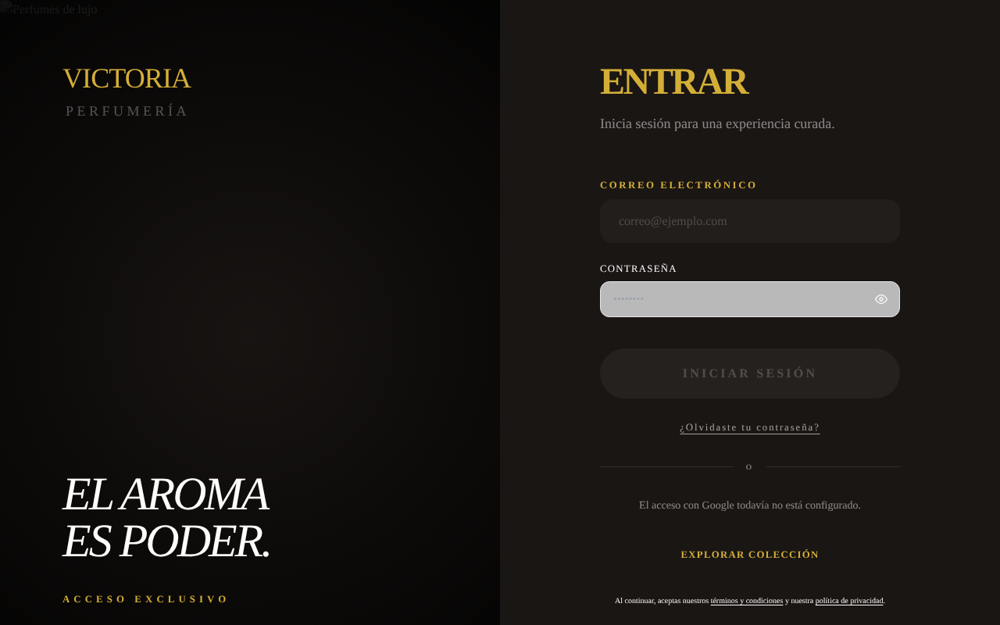
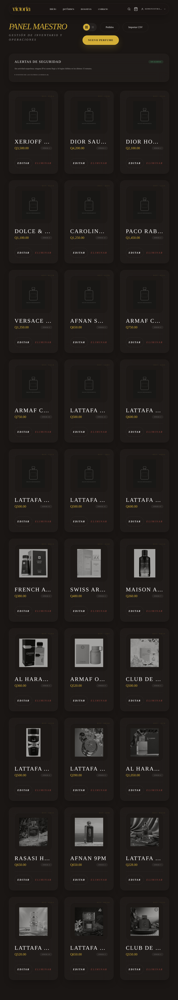
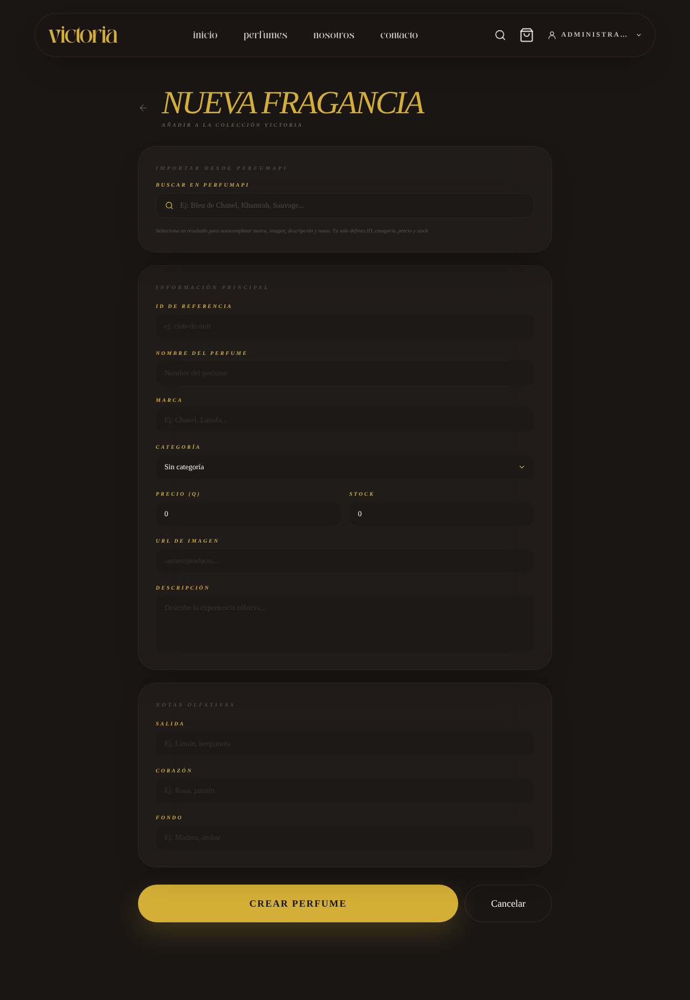
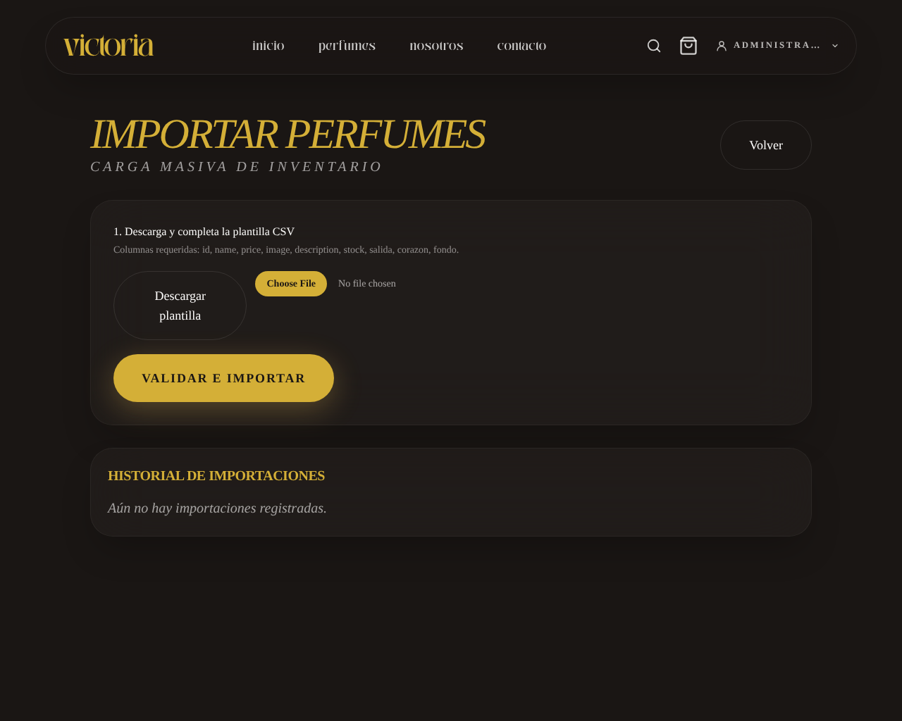
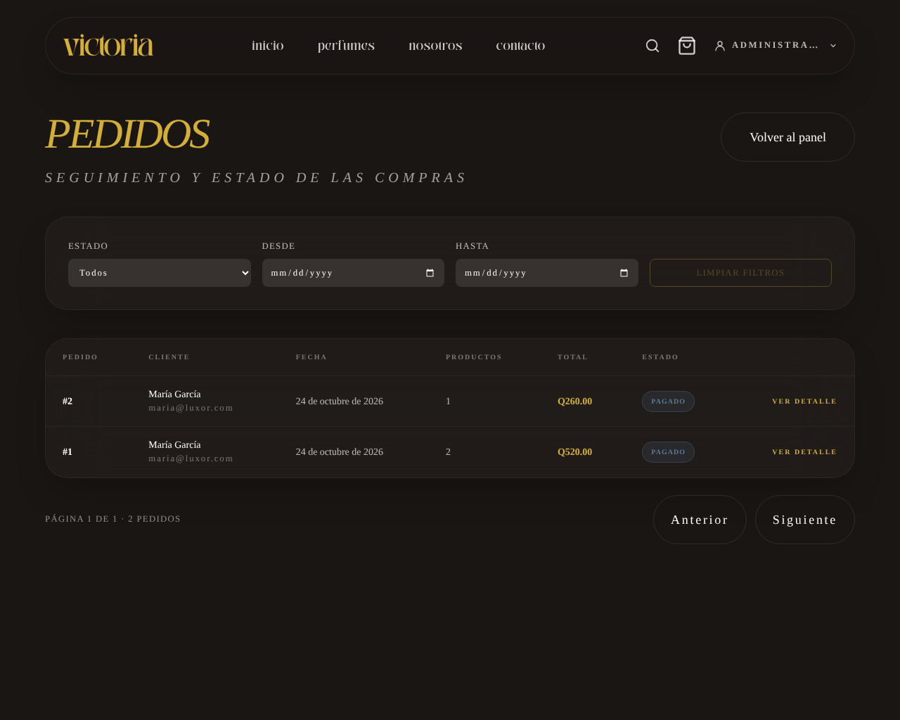
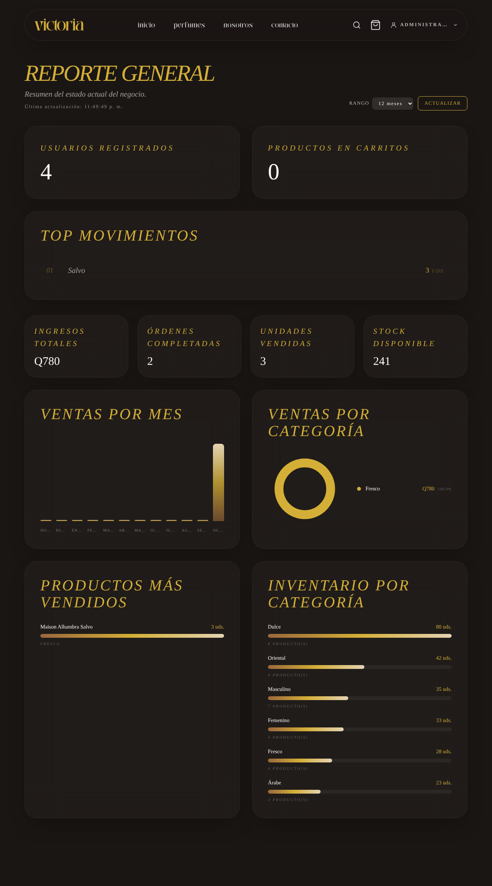

# Manual del administrador — Perfumería Victoria

Esta guía es para el personal de la tienda. Todo lo que aquí se explica solo lo puede hacer una cuenta con rol **Administrador**.

---

## 0. Entrar como administrador

1. Toca **Entrar** y escribe el correo y la contraseña de administrador.
2. Arriba a la derecha tocas tu nombre y verás los accesos **Panel**, **Pedidos** y **Reporte**.

> Nunca compartas la contraseña del administrador. Si crees que alguien la conoce, cámbiala de inmediato.

---

## Crear la cuenta de un cliente

Los clientes pueden entrar con Google o tener una cuenta creada por el administrador. Para crear una, entra a la dirección `/admin/nuevo-usuario` del sitio (por ejemplo, `https://tu-sitio.com/admin/nuevo-usuario`) con tu sesión de administrador, llena el formulario **Registrar cliente** y envíalo.

---

## 1. Panel: productos y fotos

El **Panel** muestra todos los perfumes con su precio y su stock.

**Agregar un perfume**

1. En el Panel toca **Nuevo perfume**.
2. Llena: ID de referencia (sin espacios, por ejemplo `noir-oud`), Nombre, Marca, Precio (Q), Stock y Descripción. Opcional: Salida, Corazón y Fondo (las notas del perfume).
3. En **URL de imagen** pega la dirección de la foto (por ejemplo `/assets/products/noir-oud.png`, o el enlace de una imagen en internet). La tienda guarda la dirección de la foto, no el archivo: si la foto es nueva, pide al equipo técnico que la agregue al sitio y usa su dirección.
4. Toca **Crear perfume**.

**Editar o eliminar**

- En la lista del Panel, toca el ícono del lápiz (**Editar**), cambia lo que necesites y toca **Guardar cambios**.
- El ícono de basura (**Eliminar**) borra el perfume. Aparece la pregunta "¿Seguro que quieres eliminar este producto?": léela antes de aceptar.

---

## 2. Importar perfumes con un archivo CSV

Sirve para cargar muchos perfumes de una sola vez.

1. En el Panel toca **Importar CSV**.
2. Toca **Descargar plantilla** y ábrela con Excel o Google Sheets.
3. Llena una fila por perfume con las columnas: `id, name, price, image, description, stock, salida, corazon, fondo`. No cambies los nombres ni el orden de las columnas.
4. Guarda el archivo como **CSV UTF-8** (en Excel: *Guardar como → CSV UTF-8*).
5. Toca **Elegir archivo**, selecciona tu CSV y toca **Validar e importar**.
6. El sistema importa las filas correctas y te muestra las que tienen error, con el número de fila y qué corregir (por ejemplo, un ID que ya existe). Corrige solo esas filas en un archivo nuevo y vuélvelo a subir.

---

## 3. Pedidos y estados

1. Toca **Pedidos**. Verás todas las compras (de cuenta y de invitado) con su estado, cliente y total.
2. Usa **Estado**, **Desde** y **Hasta** para filtrar. **Limpiar filtros** vuelve a mostrar todo.
3. Toca **Ver detalle** para ver los productos, la dirección (en compras de invitado) y el historial de cambios.
4. En **Cambiar estado** elige el siguiente paso.

Los pedidos avanzan en este orden:

`Pagado → En preparación → Enviado → Entregado`

Un pedido se puede **Cancelar** si está en *Pagado* o *En preparación*. Al cancelar, el stock vuelve al inventario. *Entregado* y *Cancelado* ya no se pueden cambiar.

**Correos automáticos:** cuando pasas un pedido a **Enviado**, **Entregado** o **Cancelado**, el cliente recibe un correo solo. Si el correo falla, el cambio de estado se guarda igual.

---

## 4. Cupones y reseñas

> **Nota para el equipo:** al momento de escribir este manual, la tienda **todavía no tiene** pantallas de cupones ni de reseñas de clientes. Cuando se publiquen, se agregan aquí sus pasos con capturas.

---

## 5. Reportes

1. Toca **Reporte**.
2. Verás el resumen del negocio: ventas totales, número de pedidos, perfumes más vendidos, **Ventas por mes** y **Ventas por categoría**.
3. Los pedidos cancelados no cuentan como venta.

**Visitas al sitio:** las visitas y los eventos (ver perfume, agregar al carrito, compra completada) se ven en el panel de **Vercel → proyecto → Analytics**. No usa cookies y no guarda datos personales.

---

## 6. Alertas de seguridad

En el **Panel**, abajo, está la sección **Alertas de seguridad**. Muestra intentos de inicio de sesión fallidos: fecha, tipo de evento, dirección IP y cuenta.

- Si ves **muchos intentos seguidos desde la misma IP o contra la misma cuenta**, alguien puede estar adivinando contraseñas. El sistema ya bloquea esos intentos por un rato.
- Qué hacer: cambia la contraseña de la cuenta afectada y avisa al equipo técnico.
- Si no hay eventos, aparece "No hay eventos registrados": todo está tranquilo.

---

## Si algo falla

| Problema | Qué hacer |
|---|---|
| La tienda dice "No pudimos conectar" | Espera unos minutos (el servidor gratuito puede tardar en despertar). Si sigue igual, avisa al equipo técnico. |
| Un cliente no recibió su correo | Pídele que revise spam. Verifica su correo en el detalle del pedido. |
| Un cliente dice que su pago fue rechazado | Es normal: el sistema no crea el pedido si la tarjeta es rechazada. Pídele que pruebe con otra tarjeta. |
