# Manual del administrador: Perfumería Victoria

Esta guía es para el personal de la tienda. Todo lo que aquí se explica solo lo puede hacer una cuenta con rol **Administrador**.

**Actualizado:** 10 de noviembre de 2026 (Sprint 10).

---

## 0. Entrar como administrador

1. Toca **Entrar** y escribe el correo y la contraseña de administrador.
2. Arriba a la derecha tocas tu nombre y eliges **Panel**: se abre la **consola del administrador**.

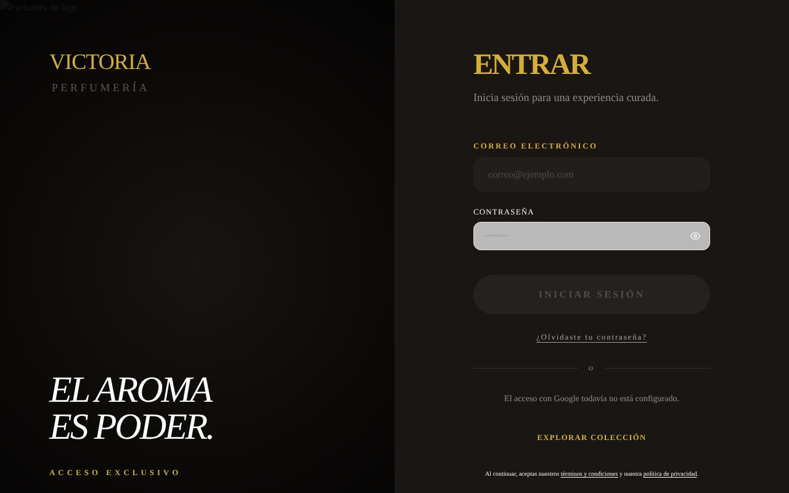

> Nunca compartas la contraseña del administrador. Si crees que alguien la conoce, cámbiala de inmediato.

> Por seguridad la sesión dura 8 horas. Si dejaste la consola abierta más tiempo, aparece el aviso **Tu sesión expiró**: toca **Inicia sesión** y vuelves a donde estabas.

---

## Crear la cuenta de un cliente

Los clientes pueden crear su cuenta solos desde **Entrar → Crear cuenta**. Si un cliente te pide que se la crees tú (por ejemplo, un mayorista):

1. En el menú de la consola toca **Clientes** y luego **Nuevo cliente**.
2. Llena el formulario **Registrar cliente**: nombre, correo y una contraseña de al menos 12 caracteres.
3. Toca **Crear Usuario**.
4. Dale al cliente su correo y su contraseña; puede cambiarla después desde **Mi cuenta**.

Las cuentas creadas así, o por el cliente, siempre son de cliente normal. Para que sea mayorista, ve al punto 7.

Cuando el cliente crea su cuenta solo, le llega un correo para confirmarla y no puede pagar con su cuenta hasta hacerlo (sí puede comprar como invitado). Las cuentas que creas tú desde **Nuevo cliente** ya quedan confirmadas.

---

## 1. La consola

La consola tiene un **menú a la izquierda** con todo agrupado: **Ventas** (Pedidos, Cupones, Reportes), **Catálogo** (Inventario, Nuevo perfume, Importar CSV, Reseñas), **Clientes** (Clientes, Mayoristas) y **Sistema** (Seguridad). En el celular el menú se abre con el botón ☰.

- **Modo claro u oscuro:** el botón de arriba a la derecha cambia el tema. La consola lo recuerda para la próxima vez.
- **Avisos en el menú:** el número naranja junto a **Pedidos** dice cuántos pedidos pagados esperan que los prepares; el rojo junto a **Inventario**, cuántos perfumes están agotados.
- **Colores:** naranja = hay que actuar ya; rojo = agotado o cancelado; ámbar = última unidad; verde = todo bien; violeta = en camino.

**Resumen.** Es la primera pantalla. Muestra lo que necesita tu atención: pedidos por preparar, agotados, perfumes con su última unidad, ventas de hoy, pedidos en camino y clientes. **Cada tarjeta se puede tocar** y abre la lista ya filtrada (por ejemplo, **Agotados** abre el inventario solo con los agotados). Abajo están las acciones rápidas y los últimos pedidos.

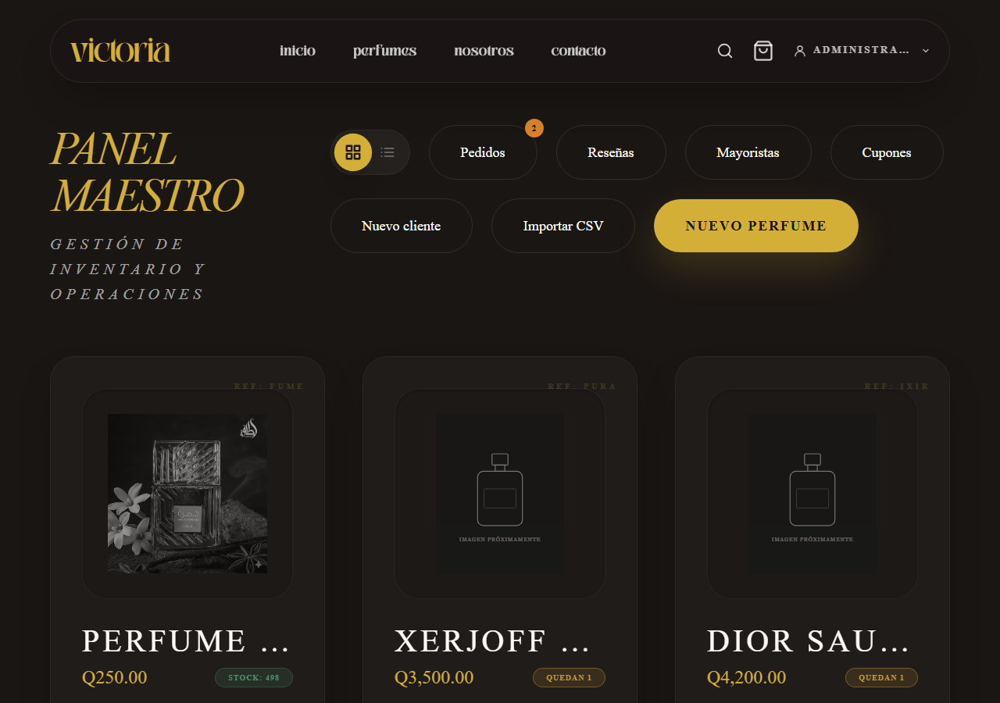

---

## 2. Inventario: buscar, filtrar y cambiar el stock

1. En el menú toca **Inventario**.
2. Arriba están las pestañas **Todos**, **Agotados**, **Última unidad** y **Disponibles**, cada una con su cantidad. Toca una para ver solo esos perfumes.
3. Para buscar, escribe el nombre, la marca o la referencia. También puedes filtrar por **categoría** y **marca**, y ordenar por nombre, stock, precio o marca. **Limpiar filtros** quita la búsqueda y los filtros.
4. **Cambiar el stock:** escribe el número nuevo en la columna **Stock** y presiona **Enter** (o toca fuera del campo). Se guarda en ese momento. Con **Escape** vuelves al número anterior.
5. Si un perfume estaba agotado y le pones stock, la tienda manda sola el correo de **Avísame cuando vuelva** a quien lo pidió, y la consola te lo confirma.
6. Abajo eliges cuántos perfumes ver por página (25, 50 o 100) y pasas de página con las flechas.

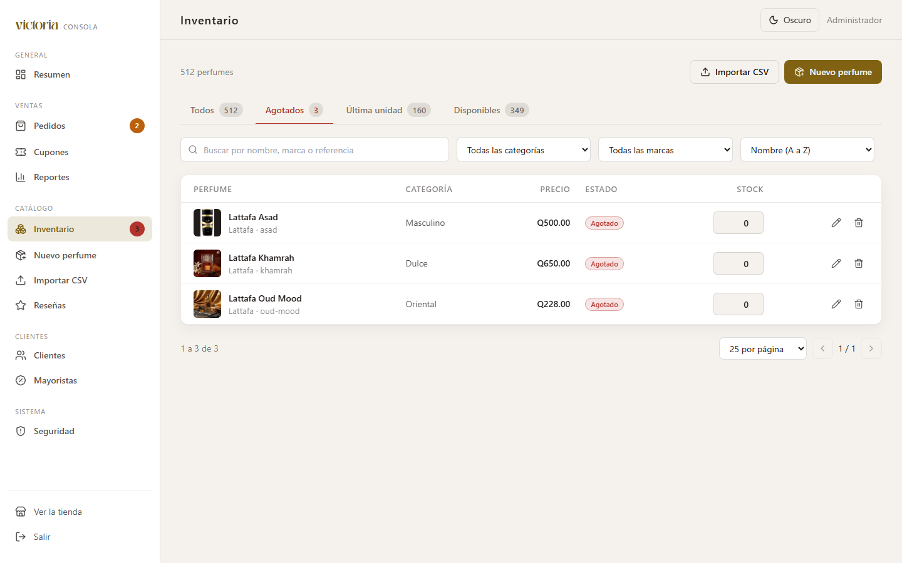

**Agregar un perfume**

1. En el menú toca **Nuevo perfume** (o el botón **Nuevo perfume** del inventario).
2. Llena: ID de referencia (sin espacios, por ejemplo `noir-oud`), Nombre, Marca, Precio (Q), Stock y Descripción. Opcional: Salida, Corazón y Fondo (las notas del perfume).
3. En **Imagen** toca **Subir foto** y elige la foto del perfume (PNG, JPG o WebP de hasta 5 MB). La tienda la achica y la guarda en WebP para que cargue rápido; al terminar aparece la vista previa. También puedes pegar la dirección de una foto que ya está en el sitio (por ejemplo `/assets/products/noir-oud.webp`) o el enlace de una imagen en internet.
4. Toca **Crear perfume**.

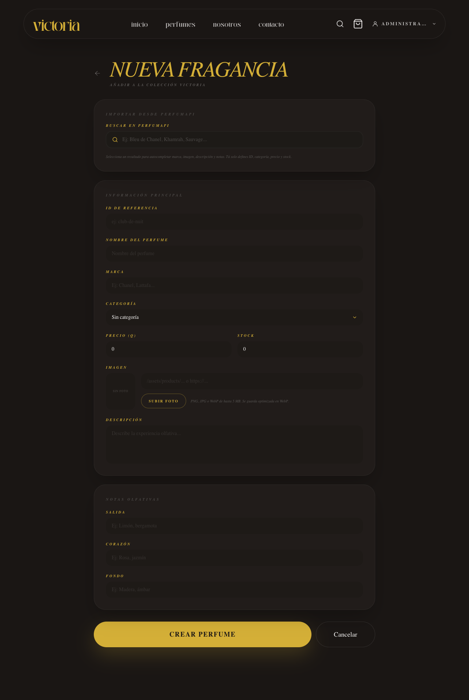

**Editar o eliminar**

- En el **Inventario**, toca el ícono del lápiz (**Editar**), cambia lo que necesites y toca **Guardar cambios**. Al guardar vuelves al inventario.
- El ícono de basura (**Eliminar**) borra el perfume y pide confirmarlo. Si el perfume ya se vendió, mejor ponle stock 0 en vez de borrarlo.

**Reponer un perfume agotado**

Cuando un perfume llega a 0 unidades, los clientes pueden pedir que se les avise (**Avísame cuando vuelva**). Al subirle el stock (editándolo, con un CSV, o cuando un pedido cancelado devuelve unidades), la tienda manda sola **un correo** a cada persona que pidió el aviso. No tienes que hacer nada más.

---

## 3. Importar perfumes con un archivo CSV

Sirve para cargar muchos perfumes de una sola vez.

1. En el menú toca **Importar CSV**.
2. Toca **Descargar plantilla** y ábrela con Excel o Google Sheets.
3. Llena una fila por perfume con las columnas: `id, name, price, image, description, stock, salida, corazon, fondo`. No cambies los nombres ni el orden de las columnas.
4. Guarda el archivo como **CSV UTF-8** (en Excel: *Guardar como → CSV UTF-8*).
5. Toca **Elegir archivo**, selecciona tu CSV y toca **Validar e importar**.
6. El sistema importa las filas correctas y te muestra las que tienen error, con el número de fila y qué corregir (por ejemplo, un ID que ya existe). Corrige solo esas filas en un archivo nuevo y vuélvelo a subir.

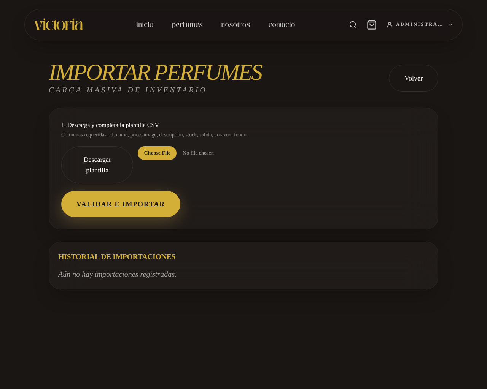

---

## 4. Pedidos y estados

1. Toca **Pedidos**. Verás todas las compras (de cuenta y de invitado) con su estado, cliente y total. Cada pedido tiene una barra de color a la izquierda según su estado, para ver de un vistazo qué falta atender.
2. Usa **Estado**, **Desde** y **Hasta** para filtrar. **Limpiar filtros** vuelve a mostrar todo.
3. Toca **Ver detalle** para ver los productos, la forma de entrega (domicilio con su dirección, o el local donde lo recogen), el cupón o descuento usado y el historial de cambios.
4. En **Cambiar estado** elige el siguiente paso.

Los pedidos avanzan en este orden:

`Pagado → En preparación → Enviado → Entregado`

| Estado | Color | Qué hacer |
|---|---|---|
| Pagado | Naranja | Pedido nuevo: hay que prepararlo ya. |
| En preparación | Azul | Lo están empacando. |
| Enviado | Violeta | Va en camino al cliente. |
| Entregado | Verde | Terminado. |
| Cancelado | Rojo | Detenido; el stock volvió al inventario. |

Un pedido se puede **Cancelar** si está en *Pagado* o *En preparación*. Al cancelar, el stock vuelve al inventario. *Entregado* y *Cancelado* ya no se pueden cambiar.

**Correos automáticos:** cuando pasas un pedido a **Enviado**, **Entregado** o **Cancelado**, el cliente recibe un correo solo. Si el correo falla, el cambio de estado se guarda igual.

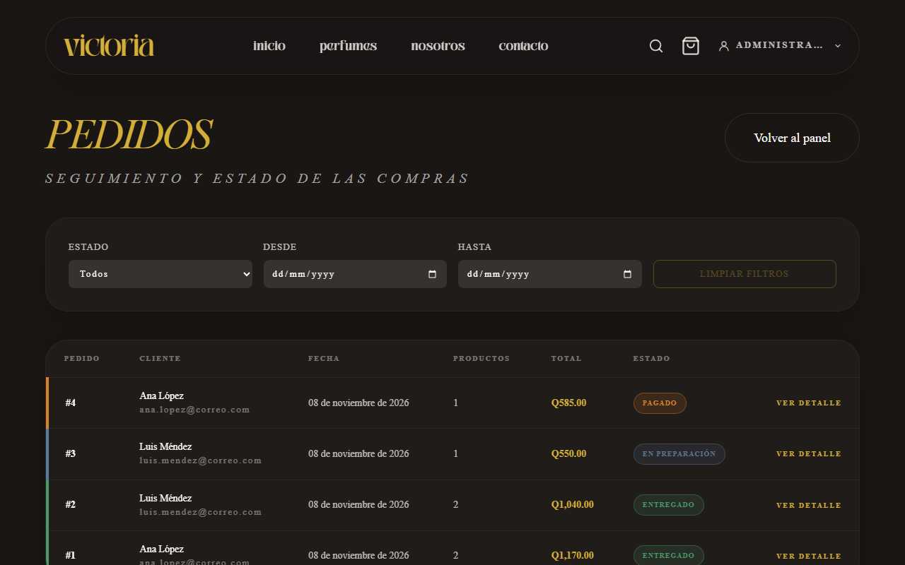

---

## 5. Cupones de descuento

1. En el menú toca **Cupones**.
2. En **Nuevo cupón** llena:
    - **Código:** de 3 a 30 letras, números, guiones o guiones bajos (por ejemplo `VERANO10`). El cliente lo escribe tal cual.
    - **Tipo:** **Porcentaje (%)** o **Monto fijo (Q)**, y su valor.
    - **Compra mínima (Q):** 0 si no tiene mínimo.
    - **Límite de usos:** vacío si no tiene límite.
    - **Vence:** el cupón sirve hasta el final de ese día.
3. Toca **Crear cupón**.
4. Abajo está la lista de cupones con su estado (**Activo**, **Vencido**, **Agotado** o **Desactivado**) y cuántas veces se usó. Con **Desactivar** lo apagas sin borrarlo; con **Activar** lo vuelves a encender.

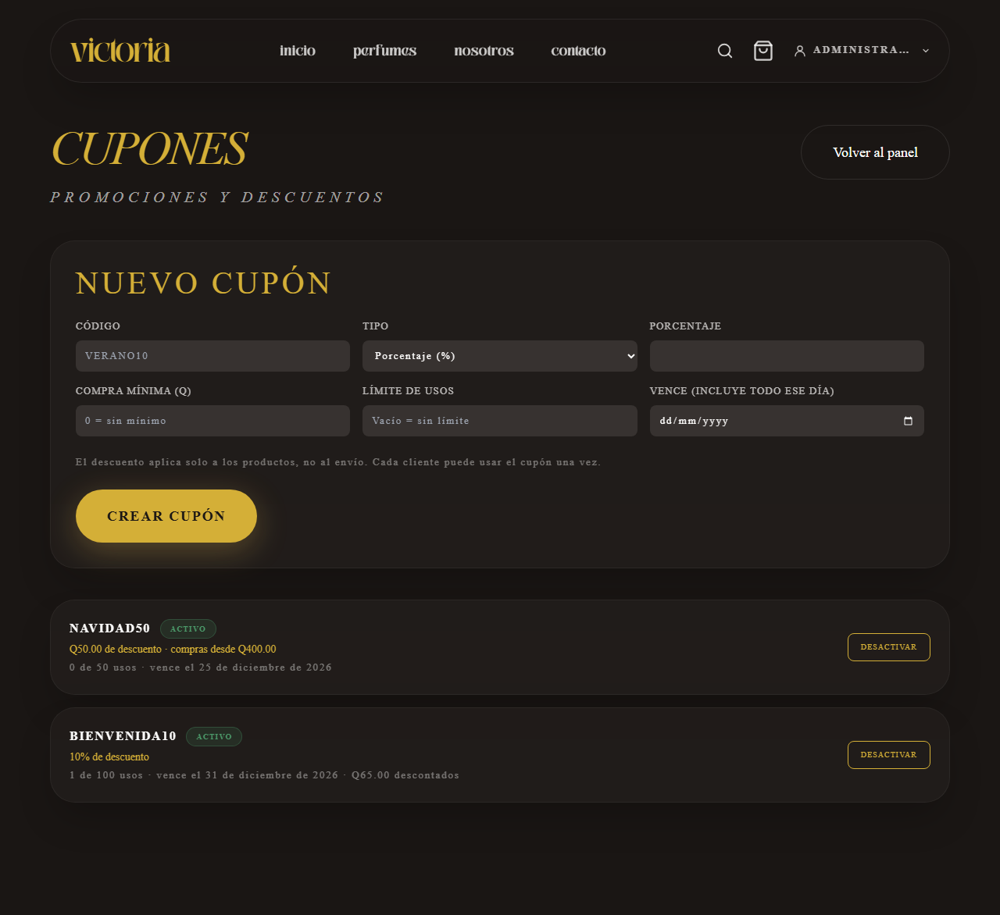

> El descuento aplica solo a los productos, no al envío, y cada cliente puede usar un cupón una vez. Los clientes mayoristas no usan cupones.

---

## 6. Reseñas de los clientes

Los clientes califican con estrellas los perfumes de sus pedidos entregados. Las reseñas se publican solas en la página del perfume.

1. En el menú toca **Reseñas**.
2. Con **Mostrar** filtras **Todas**, **Visibles** u **Ocultas**.
3. Si una reseña tiene groserías, datos personales o no habla del perfume, toca **Ocultar**: deja de verse en la tienda (y no cuenta en el promedio de estrellas). Con **Mostrar** la vuelves a publicar.

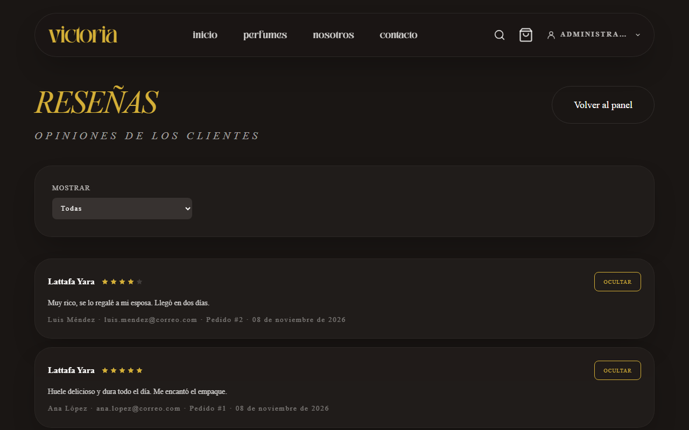

---

## 7. Clientes mayoristas

Los mayoristas pagan todos los perfumes con un descuento fijo que defines tú. No usan cupones.

1. En el menú toca **Mayoristas**.
2. En **Descuento de mayorista (%)** escribe el porcentaje y toca **Guardar**. Aplica a todos los mayoristas desde su siguiente compra.
3. Para agregar uno, en **Agregar un mayorista** busca al cliente por su nombre o correo, toca **Buscar** y luego **Hacer mayorista**. Primero debe tener su cuenta: la crea él en **Crear cuenta** o tú con **Nuevo cliente**.
4. En **Mayoristas actuales** está la lista. Toca **Quitar mayorista** para que vuelva a ser cliente normal.

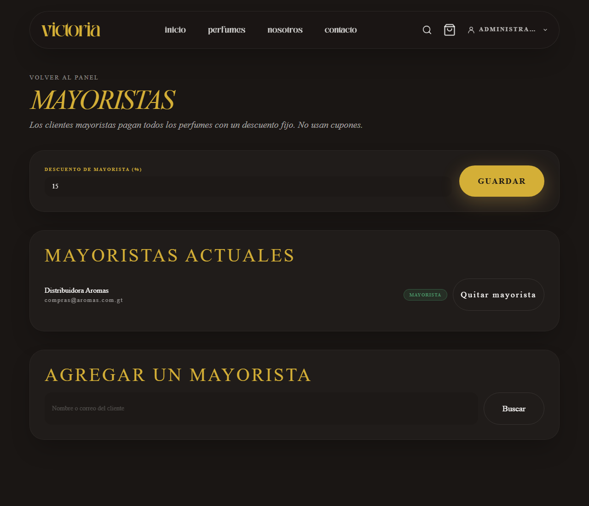

> Una cuenta de administrador nunca se puede convertir en mayorista, para evitar errores.

---

## 8. Clientes: buscar y borrar cuentas

1. En el menú toca **Clientes**.
2. Verás cada cuenta con su rol (**Cliente**, **Mayorista** o **Admin**), cuántos pedidos ha hecho, cuánto ha comprado, su último pedido y cuándo se registró. **Sin confirmar** quiere decir que todavía no confirmó su correo.
3. Arriba filtras por rol y buscas por nombre o correo.
4. **Borrar una cuenta:** toca **Borrar** y confirma. Se borran su cuenta, carrito, favoritos y reseñas; sus pedidos se quedan en los reportes y en **Pedidos** aparecen como **Cuenta eliminada**. No se puede deshacer.
5. Las cuentas de administrador dicen **Protegida**: nunca se pueden borrar, ni desde aquí ni desde Mi cuenta.

Los clientes también pueden borrar su propia cuenta desde **Mi cuenta → Borrar mi cuenta**, confirmando con su contraseña.

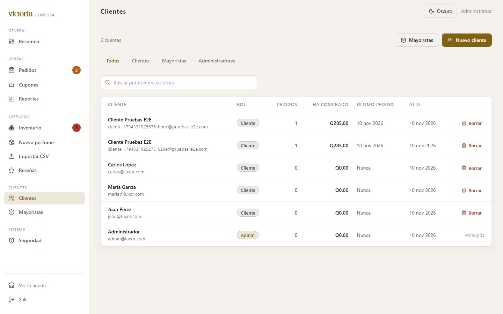

---

## 9. Reportes

1. Toca **Reporte**.
2. Verás el resumen del negocio: ventas totales, número de pedidos, perfumes más vendidos, **Ventas por mes** y **Ventas por categoría**.
3. Los pedidos cancelados no cuentan como venta.

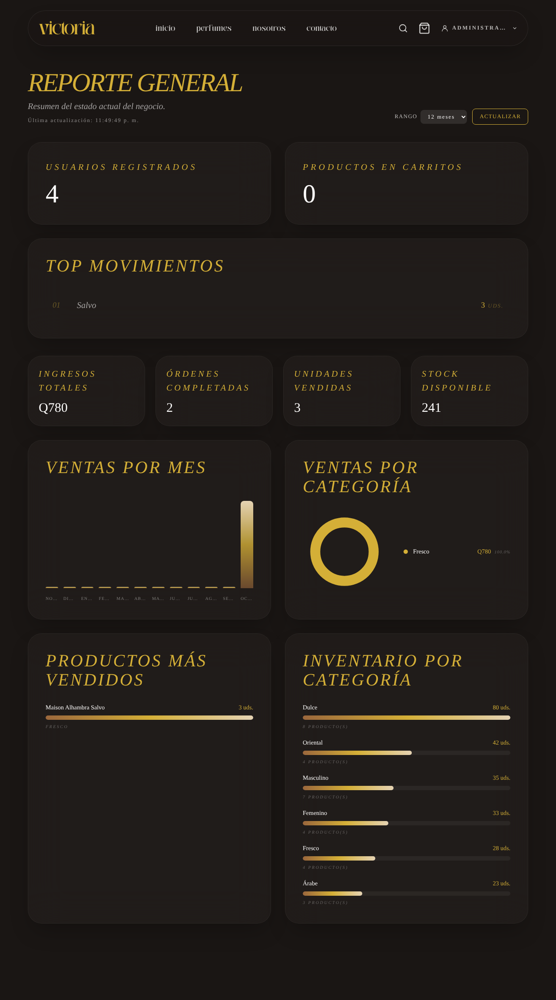

**Visitas al sitio:** las visitas y los eventos (ver perfume, agregar al carrito, compra completada) se ven en el panel de **Vercel → proyecto → Analytics**. No usa cookies y no guarda datos personales.

---

## 10. Alertas de seguridad

En el menú toca **Seguridad**: ahí están las **Alertas de seguridad**. Muestra intentos de inicio de sesión fallidos: fecha, tipo de evento, dirección IP y cuenta.

- Si ves **muchos intentos seguidos desde la misma IP o contra la misma cuenta**, alguien puede estar adivinando contraseñas. El sistema ya bloquea esa IP después de 10 intentos fallidos por minuto.
- Qué hacer: cambia la contraseña de la cuenta afectada y avisa al equipo técnico.
- Si no hay eventos, aparece "No hay eventos registrados": todo está tranquilo.

---

## Si algo falla

| Problema | Qué hacer |
|---|---|
| La tienda dice "No pudimos conectar" o tarda en cargar la primera vez | Espera un minuto (el servidor gratuito se duerme cuando nadie lo usa y tarda en despertar). Si sigue igual, avisa al equipo técnico. |
| Un cliente no recibió su correo | Pídele que revise spam. Verifica su correo en el detalle del pedido. |
| Un cliente dice que su pago fue rechazado | Es normal: el sistema no crea el pedido si la tarjeta es rechazada. Pídele que pruebe con otra tarjeta. |
| Un cliente perdió su comprobante | Si tiene cuenta, lo descarga en **Mi cuenta** (**Descargar PDF** en el pedido). Si compró como invitado, envíale los datos del detalle del pedido. |
| Un cliente no puede pagar y le sale "Confirma tu correo" | Su cuenta es nueva y no ha confirmado el correo. Que revise spam o toque **Reenviar correo** en **Mi cuenta**. Mientras tanto puede comprar como invitado. |
| Un cupón "no funciona" | Revisa en **Cupones** si está vencido, agotado o desactivado, si la compra llega al mínimo y si el cliente ya lo usó antes. |
