# Manual del comprador — Perfumería Victoria

Esta guía te explica, paso a paso, cómo comprar en la tienda. No necesitas saber de computadoras: solo seguir los pasos.

---

## 1. Buscar un perfume

1. Entra al sitio y toca **Perfumes** en la barra de arriba.
2. Verás todos los perfumes con su precio. Para encontrar uno, escribe su nombre o marca en **Buscar perfume o marca…** y los resultados se filtran solos.
3. También puedes poner un precio mínimo y máximo y tocar **Aplicar precio**.

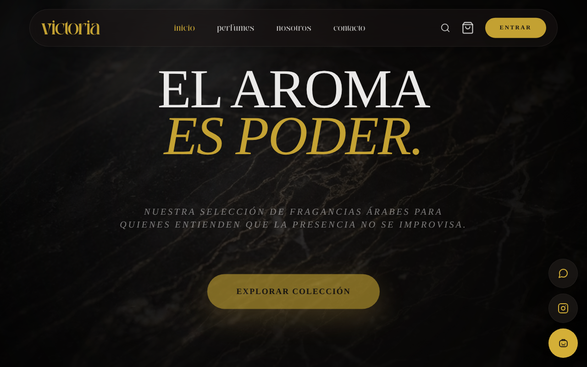

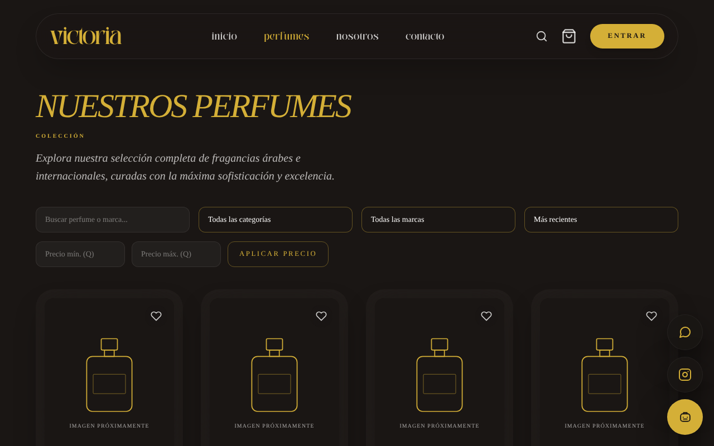

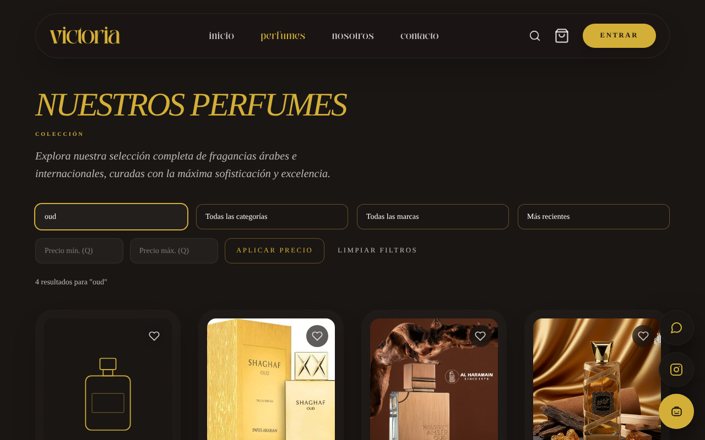

---

## 2. Ver un perfume y agregarlo al carrito

1. Toca el perfume que te guste. Verás su descripción, sus notas (salida, corazón y fondo) y cuántas unidades quedan.
2. Elige la cantidad con **−** y **+**.
3. Toca **Agregar al carrito**. Arriba, el carrito muestra un número con lo que llevas.

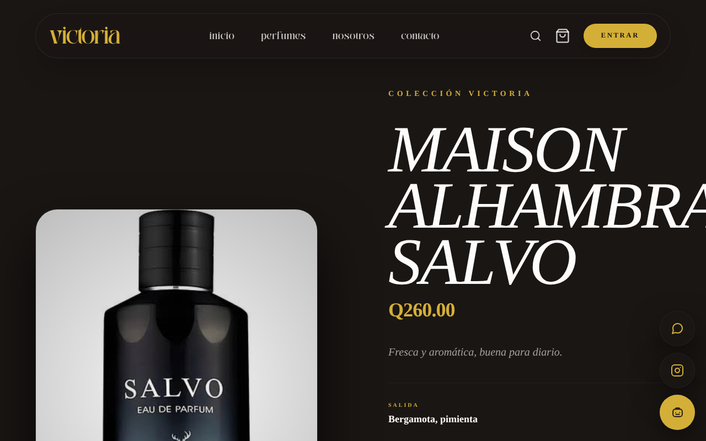

> Si ves "Agotado", ese perfume no tiene unidades por ahora. El sistema no te deja agregar más de lo que hay.

---

## 3. Comprar sin crear cuenta (invitado)

1. Toca el carrito (arriba a la derecha) para ver tu selección.
2. Toca **Comprar como invitado** (debajo del botón de pagar).
3. Escribe tu nombre completo, tu correo y tu dirección de entrega.
4. Escribe los datos de tu tarjeta y toca **Confirmar y pagar**.
5. Verás tu número de pedido. **Guárdalo**: lo necesitas si quieres preguntar por tu compra por WhatsApp.
6. Te llegará un correo con el resumen de tu pedido al correo que escribiste.

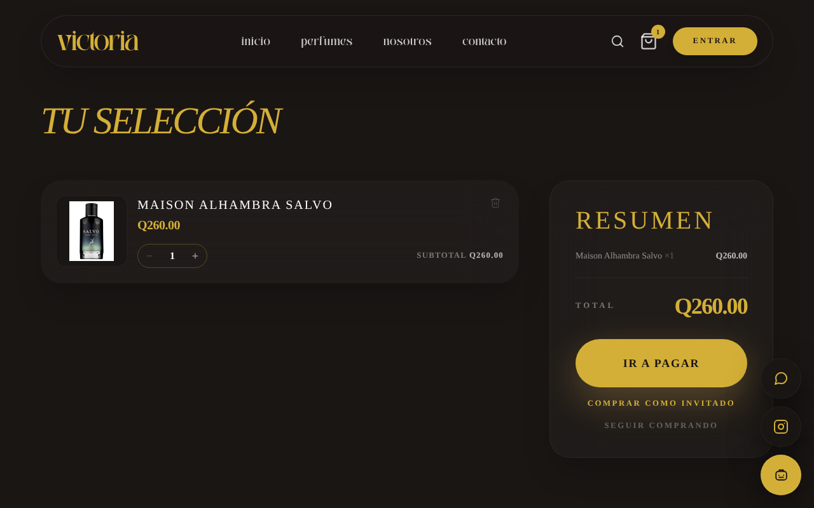

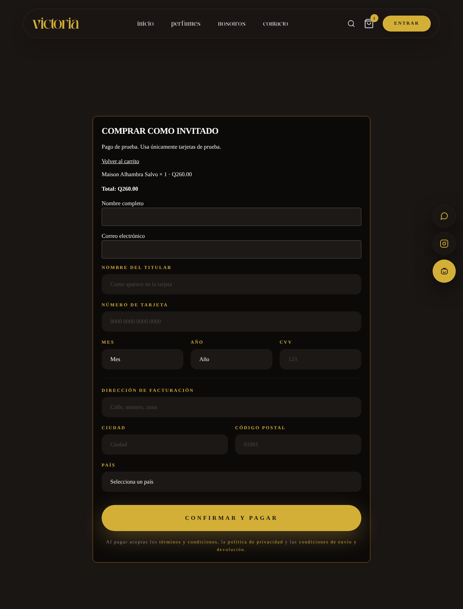

---

## 4. Comprar con tu cuenta

Con una cuenta puedes guardar tu carrito, ver tu historial y seguir tus pedidos.

1. Toca **Entrar**, escribe tu correo y tu contraseña, y toca **Iniciar sesión**. (Las cuentas las crea el administrador de la tienda o puedes entrar con tu cuenta de Google. Si no tienes ninguna, compra como invitado, como en el punto 3.)
2. Agrega tus perfumes al carrito y toca **Ir a pagar**.
3. Llena el formulario de pago: nombre del titular, número de tarjeta, mes, año, CVV, dirección, ciudad, código postal y país.
4. Toca **Confirmar y pagar**.
5. Verás la confirmación con tu número de pedido y recibirás un correo con el resumen.

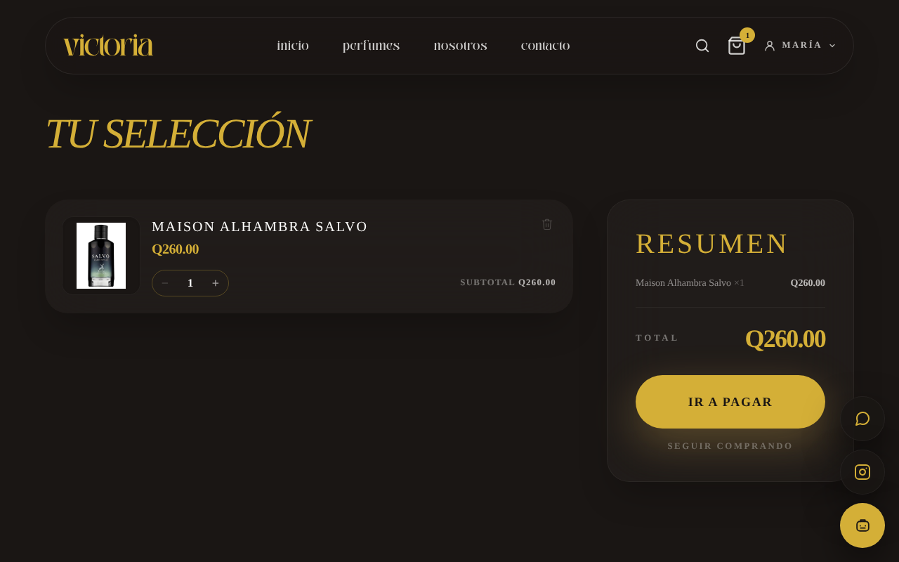

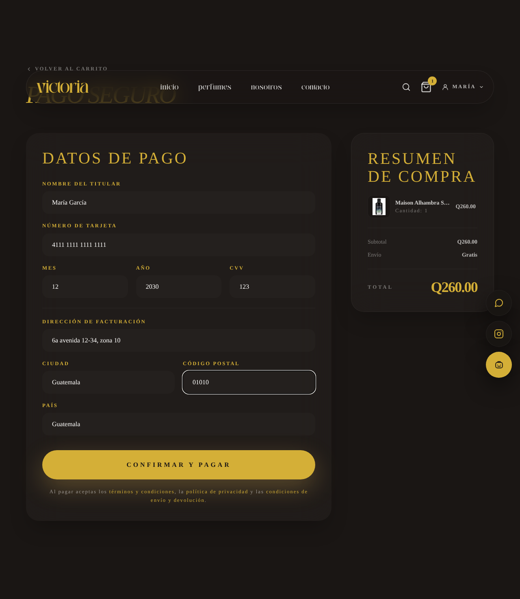

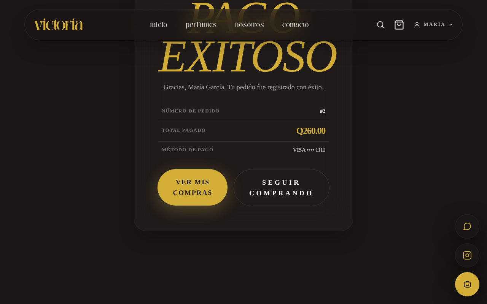

> Si el pago es rechazado, la página te dice el motivo (por ejemplo, fondos insuficientes). **No se crea el pedido ni se cobra nada.** Puedes intentar con otra tarjeta.

---

## 5. Seguir un pedido

1. Toca tu nombre arriba a la derecha y entra a **Mi cuenta**.
2. Baja hasta **Historial de pedidos**.
3. Cada pedido muestra su estado. Toca **Seguimiento** para ver las fechas de cada cambio.

Los estados son:

| Estado | Qué significa |
|---|---|
| Pagado | Recibimos tu pago. |
| En preparación | Estamos empacando tu pedido. |
| Enviado | Tu pedido va en camino (te avisamos por correo). |
| Entregado | Ya te llegó (te avisamos por correo). |
| Cancelado | El pedido se canceló (te avisamos por correo). |

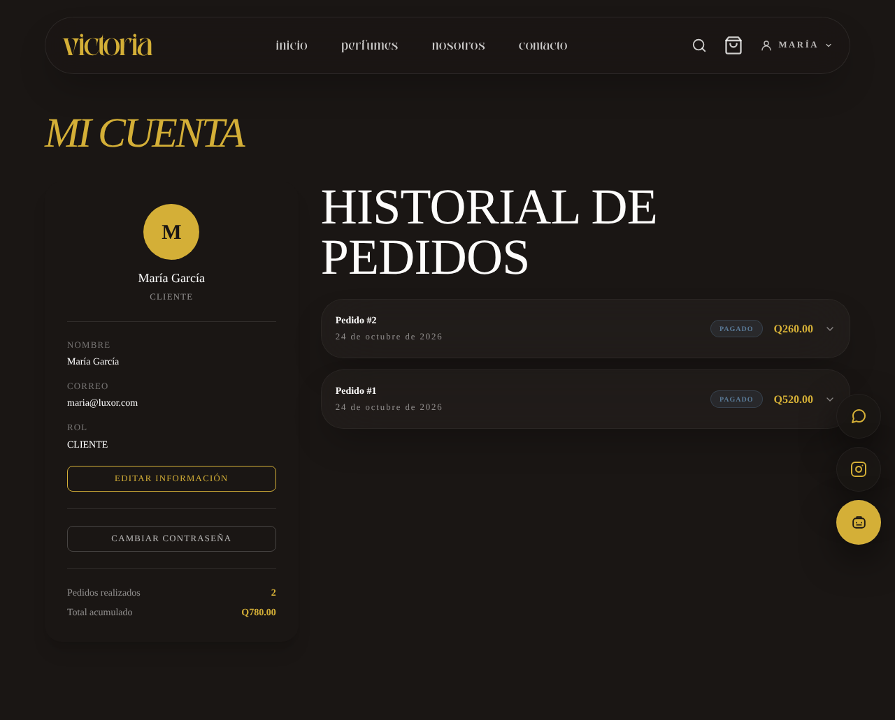

> Si compraste como invitado, no tienes "Mi cuenta": escríbenos por WhatsApp con tu número de pedido y te decimos cómo va.

---

## 6. Favoritos

1. Entra con tu cuenta.
2. En la página de un perfume, toca **Guardar en favoritos**.
3. Para verlos todos, toca tu nombre arriba y elige **Favoritos**. Toca un perfume de la lista para abrirlo y agregarlo al carrito.

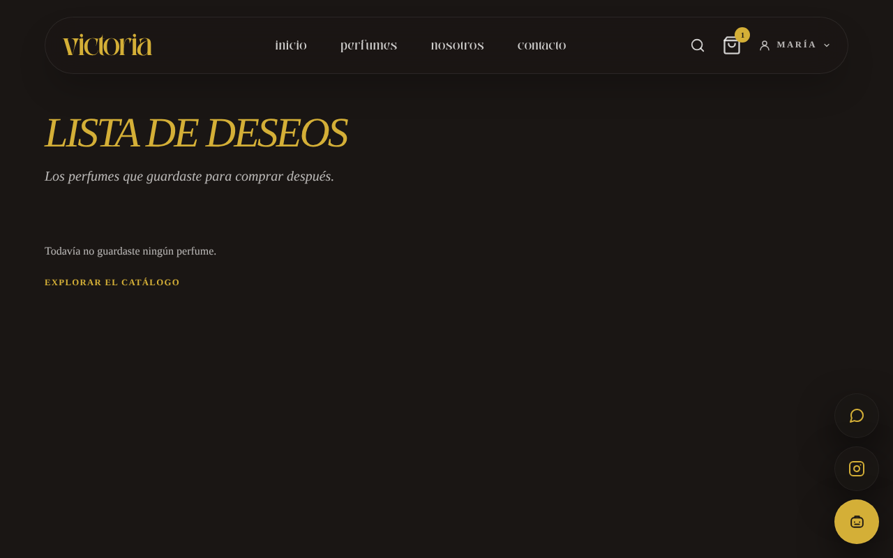

---

## 7. Recuperar mi contraseña

1. En la página de **Entrar**, toca **¿Olvidaste tu contraseña?**
2. Escribe tu correo y envía el formulario. Te llegará un correo con un enlace (vence en 30 minutos).
3. Toca el enlace, escribe tu nueva contraseña y confirma.
4. Entra con tu nueva contraseña.

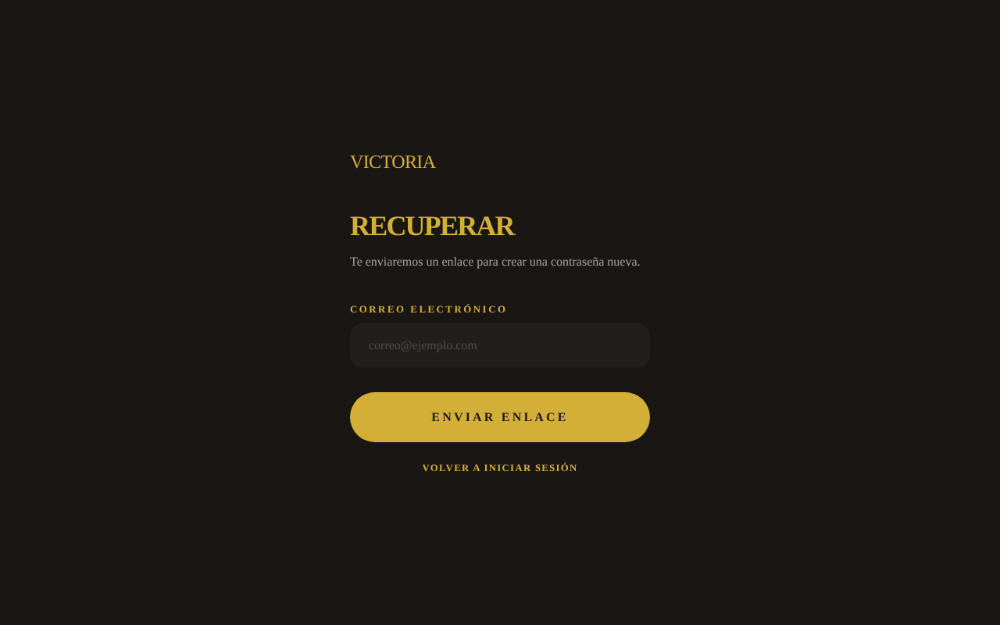

> Por seguridad, la página siempre dice que "si el correo existe, se envió el mensaje". Si no te llega, revisa la carpeta de spam.

---

## Preguntas rápidas

- **¿Es seguro pagar?** Sí. El sitio usa HTTPS y nunca guardamos tu número completo de tarjeta ni tu CVV.
- **¿Necesito cuenta?** No. Puedes comprar como invitado.
- **¿Tienen alguna duda?** Escríbenos por WhatsApp o usa el asistente virtual (el botón dorado abajo a la derecha).
