# Manual del comprador: Perfumería Victoria

Esta guía te explica, paso a paso, cómo comprar en la tienda. No necesitas saber de computadoras: solo seguir los pasos.

**Actualizado:** 8 de noviembre de 2026 (Sprint 10).

---

## 1. Buscar un perfume

1. Entra al sitio. En la portada, la sección **Los favoritos de nuestros clientes** muestra los perfumes que más se venden. Toca una pestaña (Dulce, Femenino, Fresco, Masculino, Oriental, Árabe) para ver los más vendidos de esa categoría.
2. Para ver todo el catálogo, toca **Perfumes** en la barra de arriba.
3. Para encontrar un perfume, escribe su nombre o marca en **Buscar perfume o marca…** y los resultados se filtran solos.
4. También puedes poner un precio mínimo y máximo y tocar **Aplicar precio**.

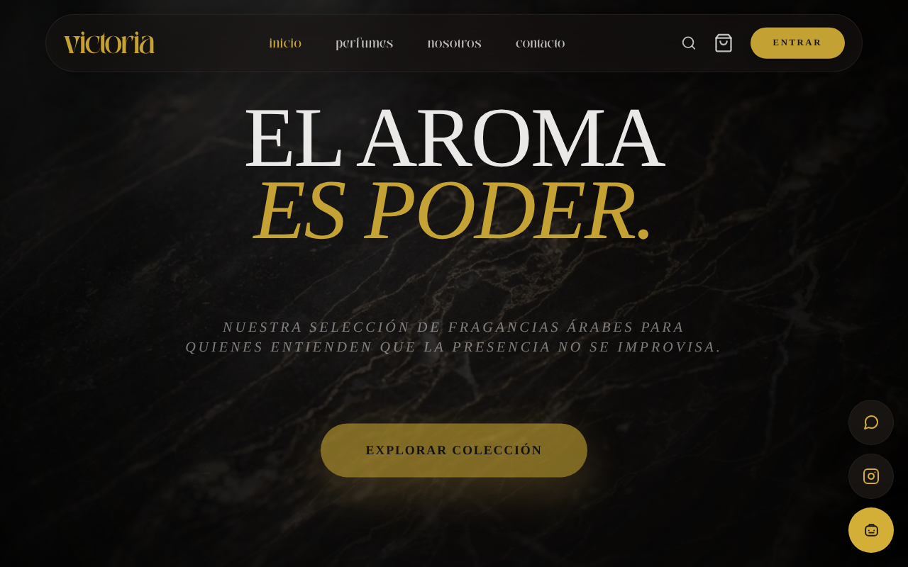

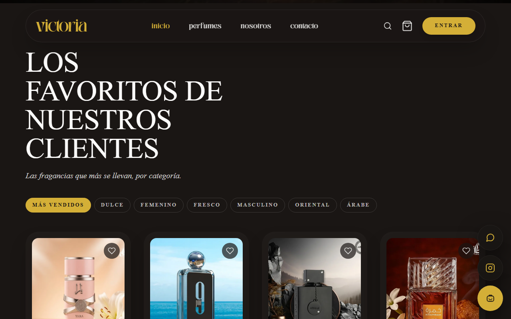

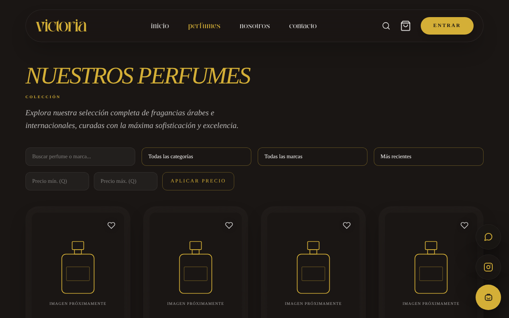

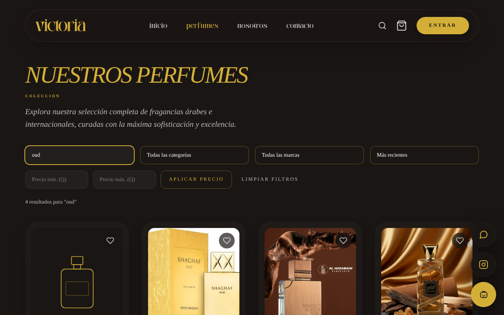

---

## 2. Ver un perfume y agregarlo al carrito

1. Toca el perfume que te guste. Verás su descripción, sus notas (salida, corazón y fondo) y cuántas unidades quedan.
2. Elige la cantidad con **−** y **+**.
3. Toca **Agregar al carrito**. Arriba, el carrito muestra un número con lo que llevas.
4. Más abajo están las **Reseñas**: la calificación promedio en estrellas y lo que opinaron otros clientes que ya recibieron ese perfume.

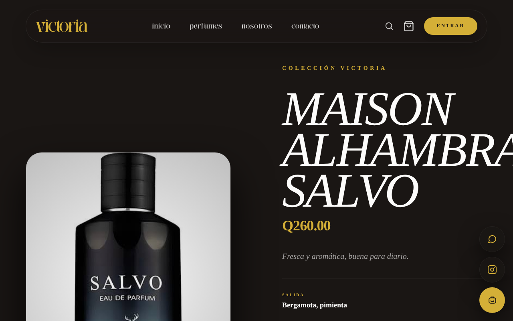

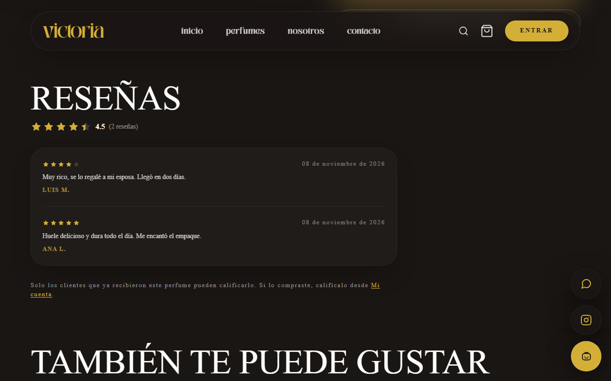

### Si el perfume está agotado

Si ves **Agotado**, ese perfume no tiene unidades por ahora. Puedes pedir que te avisemos:

1. Toca **Avísame cuando vuelva**.
2. Escribe tu correo y marca la casilla para aceptar el aviso.
3. Toca **Avisarme**.
4. Cuando la tienda reponga el perfume, te llega **un solo correo** avisándote. Si cambias de opinión, el mismo correo trae un enlace para cancelar el aviso.

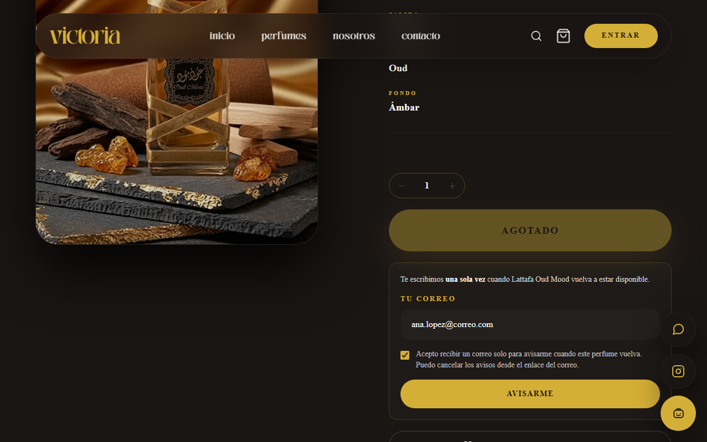

> El sistema no te deja agregar al carrito más unidades de las que hay.

---

## 3. Comprar sin crear cuenta (invitado)

1. Toca el carrito (arriba a la derecha) para ver tu selección.
2. Toca **Comprar como invitado** (debajo del botón de pagar).
3. Escribe tu nombre completo y tu correo.
4. Elige **Envío a domicilio** (Q35, gratis desde Q500 en productos) o **Recoger en tienda** (gratis, eliges el local). El resumen muestra el envío y el total.
5. Si tienes un cupón, escríbelo y toca **Aplicar** (ver el punto 5).
6. Toca **Continuar al pago seguro**. Se abre la página de Recurrente, nuestro procesador de pagos: ahí escribes los datos de tu tarjeta y pagas.
7. Al terminar regresas a la tienda y verás tu número de pedido. **Guárdalo**: lo necesitas si quieres preguntar por tu compra por WhatsApp o en el asistente virtual.
8. En esa misma pantalla puedes tocar **Descargar PDF** para guardar tu comprobante, o **Imprimir**.
9. Te llegará un correo con el resumen de tu pedido al correo que escribiste.

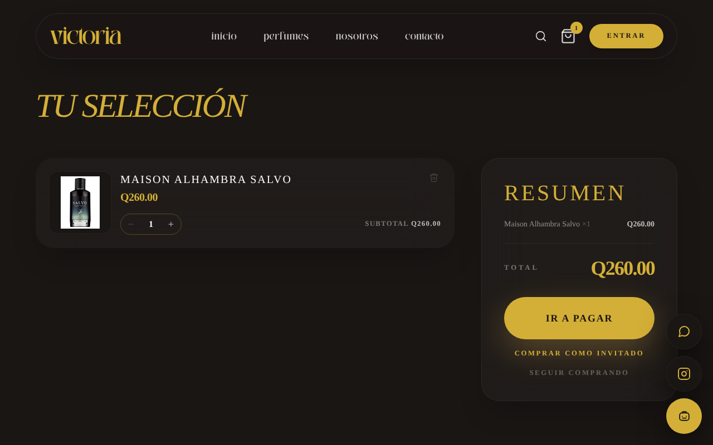

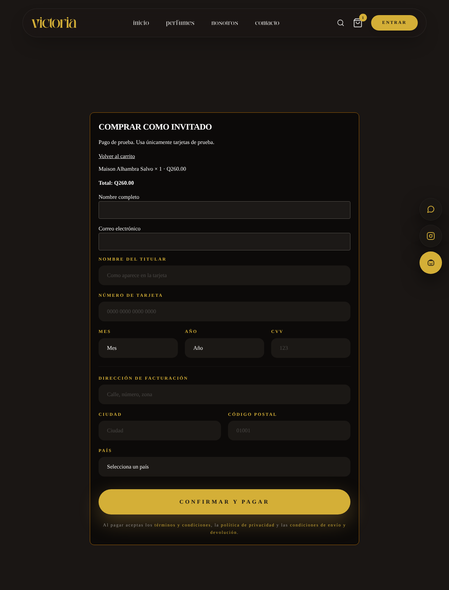

---

## 4. Comprar con tu cuenta

Con una cuenta puedes guardar tu carrito, ver tu historial, seguir tus pedidos y calificar los perfumes que recibiste.

**Crear tu cuenta (solo la primera vez)**

1. Toca **Entrar** y, debajo del formulario, toca **Crear cuenta**.
2. Escribe tu nombre completo, tu correo y una contraseña de al menos 12 caracteres. Repite la contraseña en **Confirmar contraseña**.
3. Toca **Crear cuenta**. La tienda te deja con la sesión iniciada y te regresa a donde estabas.

Si el correo ya tiene una cuenta, la página te lo dice: entra con **Inicia sesión** o usa **¿Olvidaste tu contraseña?**

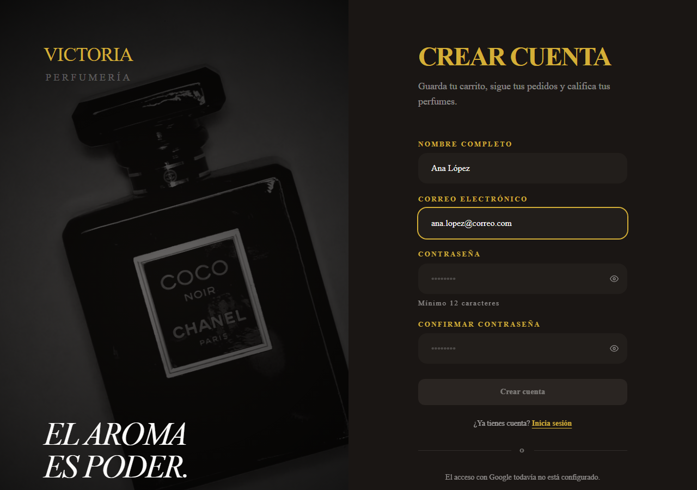

**Comprar**

1. Toca **Entrar**, escribe tu correo y tu contraseña, y toca **Iniciar sesión**.
2. Agrega tus perfumes al carrito y toca **Ir a pagar**.
3. Elige **Envío a domicilio** y escribe tu dirección, o **Recoger en tienda** y elige el local. El envío cuesta Q35 y es gratis desde Q500 en productos o al recoger.
4. Si tienes un cupón, aplícalo (ver el punto 5).
5. Toca **Continuar al pago seguro**. En la página de Recurrente escribes los datos de tu tarjeta y pagas.
6. Al regresar a la tienda verás **¡Compra confirmada!** con tu número de pedido, los productos, el descuento, el envío y la tarjeta con la que pagaste (solo los últimos 4 dígitos). Ahí puedes tocar **Descargar PDF** o **Imprimir** para tener tu comprobante.
7. También recibirás un correo con el resumen.

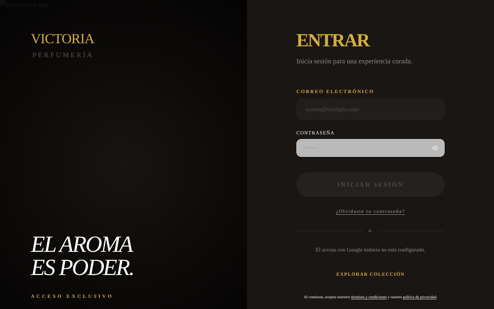

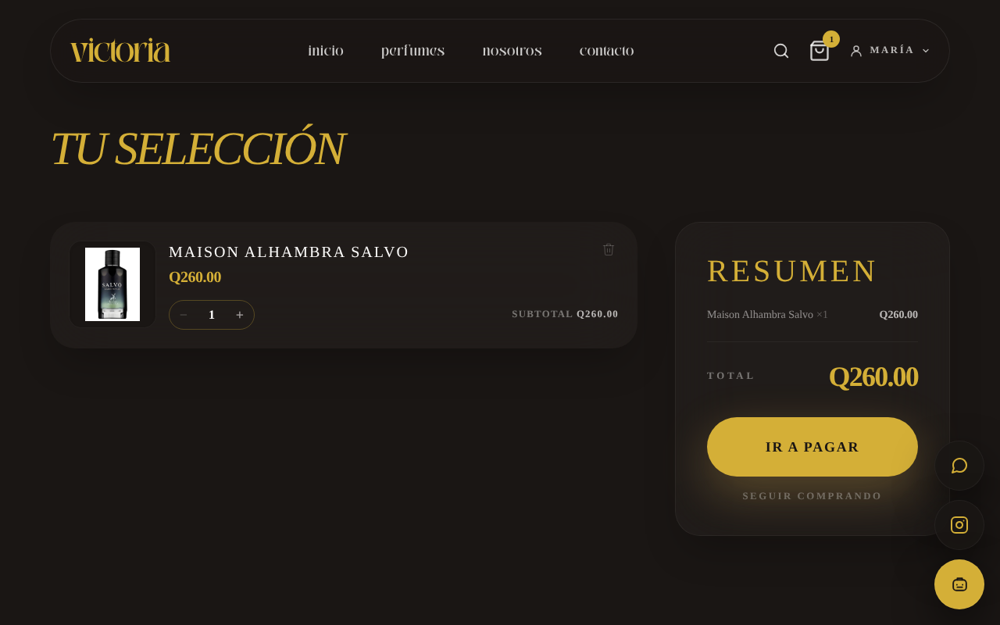

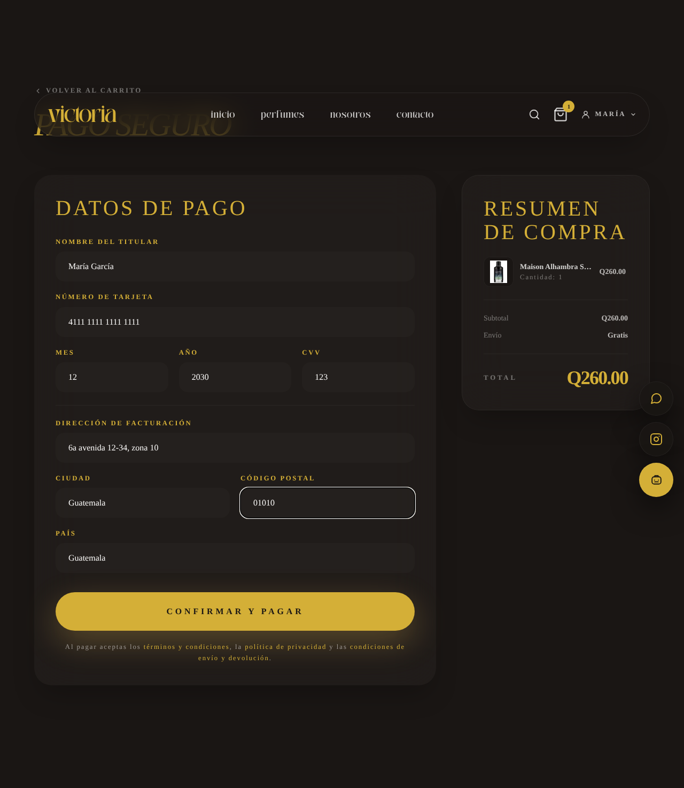

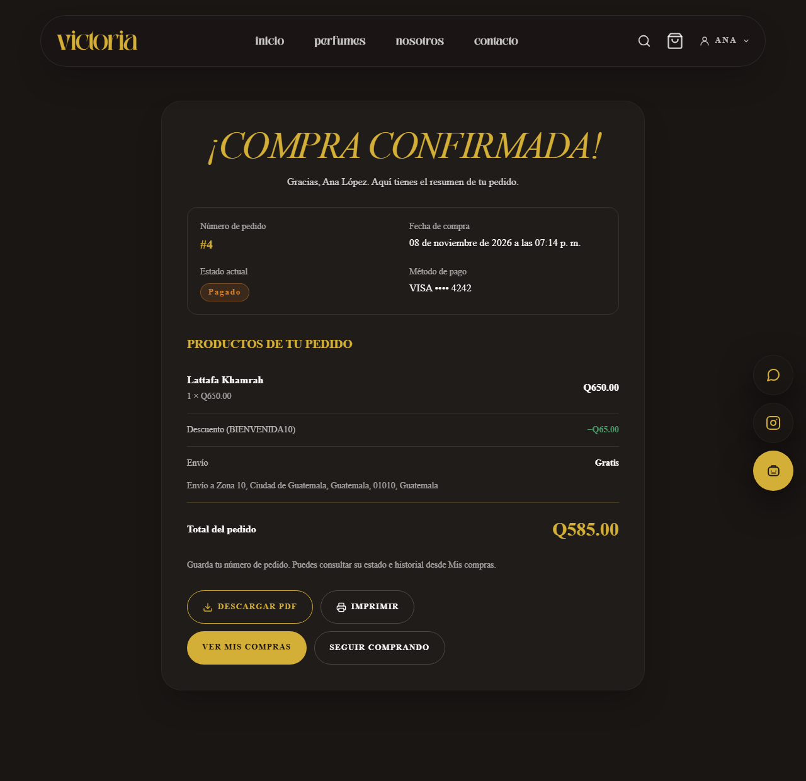

> Si el pago es rechazado, la página de Recurrente te dice el motivo (por ejemplo, fondos insuficientes) y puedes intentar con otra tarjeta ahí mismo. Si te sales sin pagar, **no se crea el pedido ni se cobra nada** y tu carrito sigue guardado.

---

## 5. Usar un cupón de descuento

1. En el carrito o en la página de pago, busca el campo **CÓDIGO**.
2. Escribe el código que te dio la tienda (por ejemplo `BIENVENIDA10`) y toca **Aplicar**.
3. Si el cupón es válido, aparece con su descuento y el resumen muestra la rebaja. Para quitarlo, toca **Quitar**.

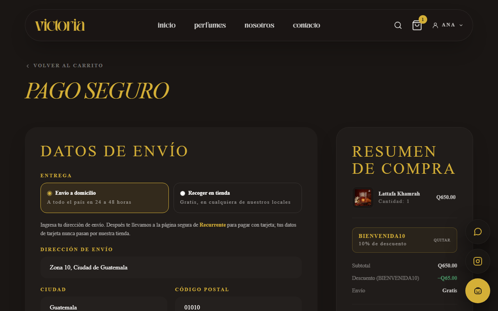

Ten en cuenta:

- El descuento se aplica a los perfumes, no al envío.
- Cada cliente puede usar un mismo cupón una sola vez.
- Algunos cupones piden una compra mínima o vencen en una fecha. Si no se cumple, la tienda te dice por qué no se aplicó.

---

## 6. Seguir un pedido y descargar el comprobante

1. Toca tu nombre arriba a la derecha y entra a **Mi cuenta**.
2. En **Historial de pedidos** verás cada pedido con su estado en un color distinto.
3. Toca un pedido para abrirlo: verás los productos, el envío, el total y el **Seguimiento** con la fecha de cada cambio.
4. Toca **Descargar PDF** para bajar el comprobante de ese pedido cuando lo necesites.

Los estados son:

| Estado | Color | Qué significa |
|---|---|---|
| Pagado | Naranja | Recibimos tu pago. |
| En preparación | Azul | Estamos empacando tu pedido. |
| Enviado | Violeta | Tu pedido va en camino (te avisamos por correo). |
| Entregado | Verde | Ya te llegó (te avisamos por correo). |
| Cancelado | Rojo | El pedido se canceló (te avisamos por correo). |

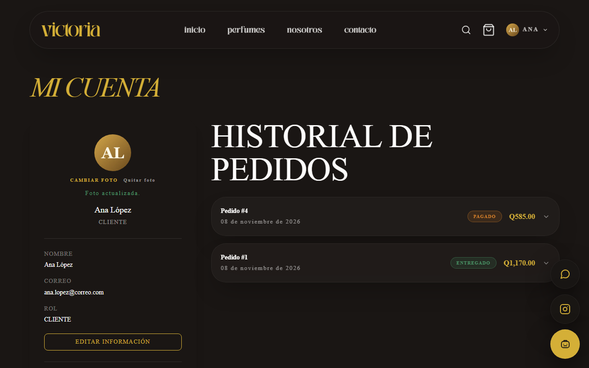

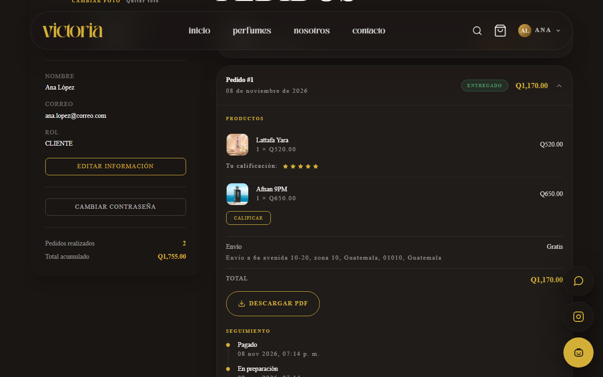

> Si compraste como invitado, no tienes "Mi cuenta": escríbenos por WhatsApp con tu número de pedido, o pregúntale al asistente virtual con tu número de pedido y tu correo.

---

## 7. Calificar un perfume

Solo puedes calificar los perfumes de un pedido que ya está **Entregado**.

1. En **Mi cuenta**, abre el pedido entregado.
2. Junto al perfume, toca **Calificar**.
3. Elige de 1 a 5 estrellas y, si quieres, escribe un comentario.
4. Toca **Publicar reseña**. Tu opinión aparece en la página del perfume con tu nombre y la inicial de tu apellido.

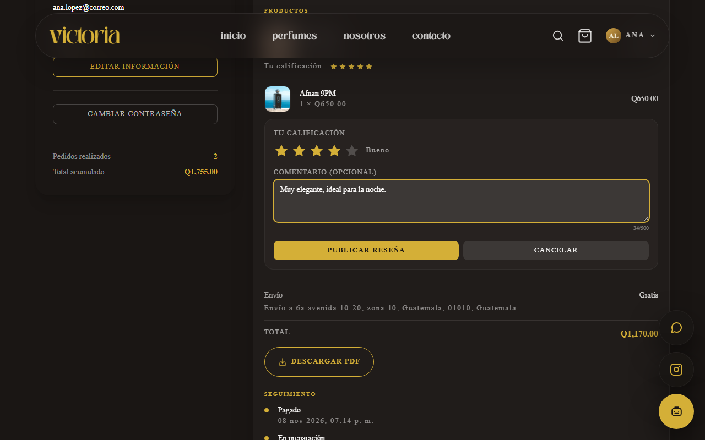

> Cada perfume se califica una vez por pedido. La tienda puede ocultar reseñas que no sean apropiadas.

---

## 8. Tu foto de perfil y tus datos

1. En **Mi cuenta**, toca **Subir foto** (o **Cambiar foto** si ya tienes una) y elige una imagen PNG, JPG o WebP de hasta 5 MB. Tu foto aparece también arriba, junto a tu nombre.
2. Para quitarla, toca **Quitar foto**.
3. Con **Editar información** cambias tu nombre y tu correo. Con **Cambiar contraseña** pones una nueva (al guardarla, vuelves a iniciar sesión).

---

## 9. Recoger en tienda: locales, horarios y cómo llegar

Si eliges **Recoger en tienda** al pagar, no pagas envío y pasas por tu pedido a cualquiera de los locales, de lunes a sábado:

| Local | Dirección | Horario |
|---|---|---|
| Joyería Victoria | Metro Centro, 19 calle 3-31, Zona 1 | 9:00 a 17:00 |
| Joyería Glamour | C.C. El Pueblito, Zona 1 | 8:00 a 17:00 |
| Joyería Luxor | C.C. San Isidro, Zona 16 | 10:00 a 19:00 |

En la página **Envíos y devoluciones** (enlace al pie de la página) cada local tiene su mapa. Toca **Cómo llegar con Waze** para abrir la ruta en tu celular.

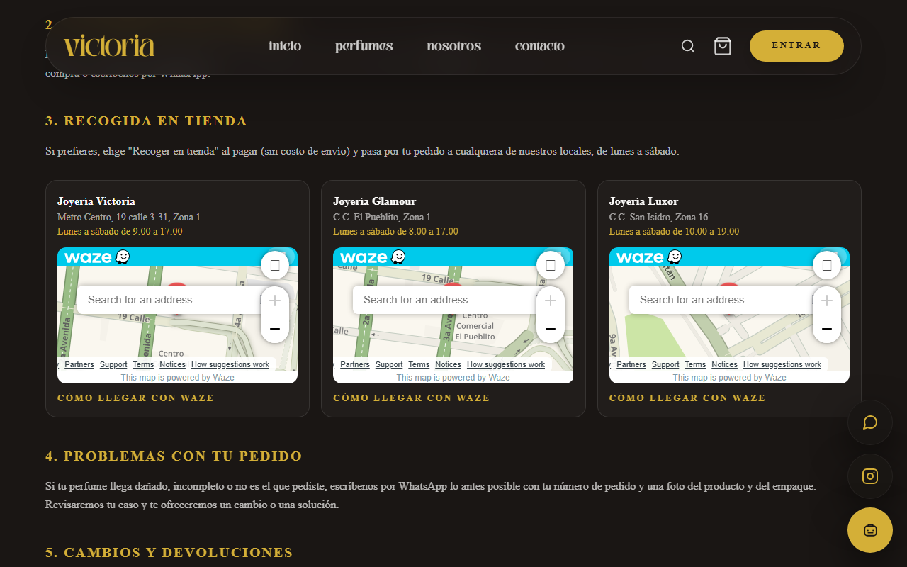

---

## 10. Clientes mayoristas

Si compras al por mayor, pide a la tienda que convierta tu cuenta en **Mayorista**. Desde ese momento:

- Todos los perfumes te salen con el descuento de mayorista (en el resumen aparece como **Precio mayorista**).
- No necesitas cupones: el descuento de mayorista ya se aplica solo y no se combina con cupones.

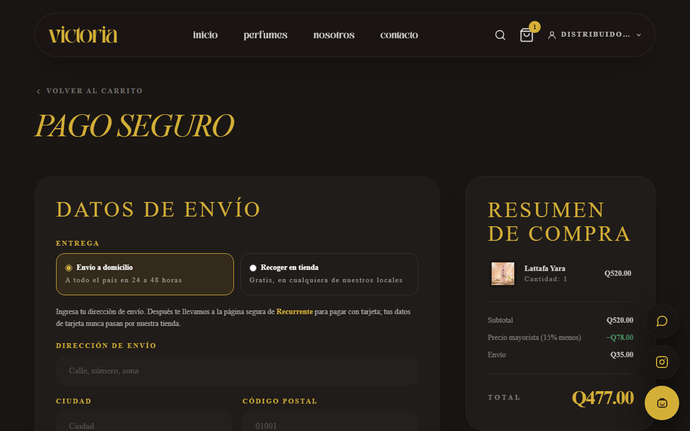

---

## 11. Favoritos

1. Entra con tu cuenta.
2. En la página de un perfume, toca **Guardar en favoritos**.
3. Para verlos todos, toca tu nombre arriba y elige **Favoritos**. Toca un perfume de la lista para abrirlo y agregarlo al carrito.

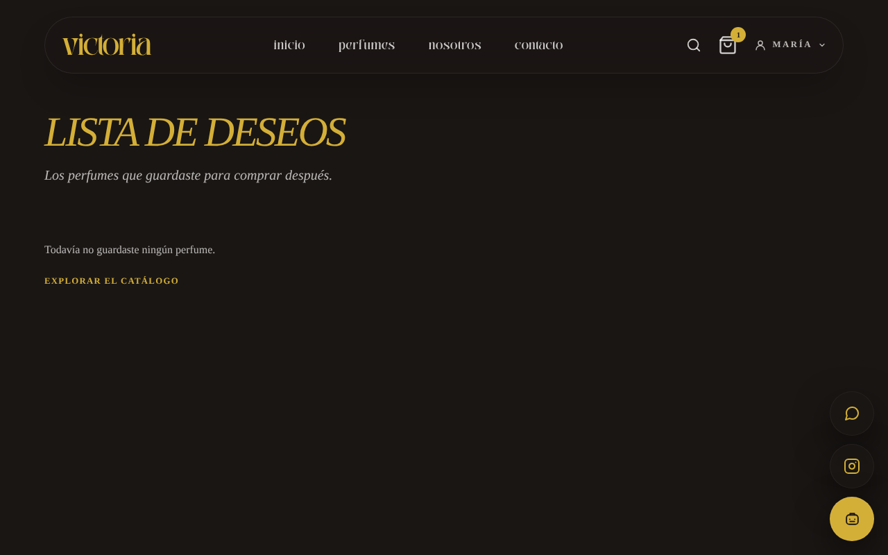

---

## 12. Recuperar mi contraseña

1. En la página de **Entrar**, toca **¿Olvidaste tu contraseña?**
2. Escribe tu correo y envía el formulario. Te llegará un correo con un enlace (vence en 30 minutos).
3. Toca el enlace, escribe tu nueva contraseña (al menos 12 caracteres) y confirma.
4. Entra con tu nueva contraseña.

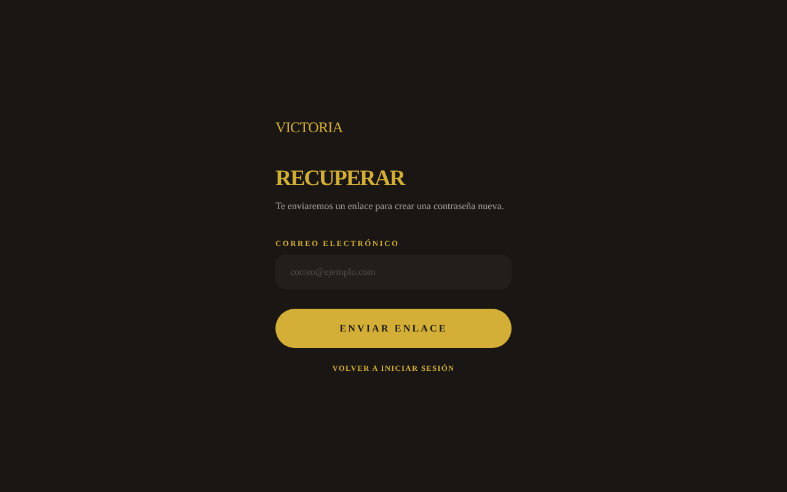

> Por seguridad, la página siempre dice que "si el correo existe, se envió el mensaje". Si no te llega, revisa la carpeta de spam.

---

## Preguntas rápidas

- **¿Es seguro pagar?** Sí. Pagas en la página segura de Recurrente, así que los datos de tu tarjeta nunca pasan por nuestra tienda.
- **¿Necesito cuenta?** No. Puedes comprar como invitado. Si quieres una, créala en **Entrar → Crear cuenta** (ver el punto 4).
- **Me salió "Tu sesión expiró".** Por seguridad, la sesión dura 8 horas. Toca **Inicia sesión** en el aviso y sigue donde estabas; tu carrito queda guardado.
- **¿Dónde está mi comprobante?** En la pantalla de confirmación de la compra y, si tienes cuenta, en **Mi cuenta** dentro de cada pedido (**Descargar PDF**).
- **¿Tienen alguna duda?** Escríbenos por WhatsApp o usa el asistente virtual (el botón dorado abajo a la derecha).
